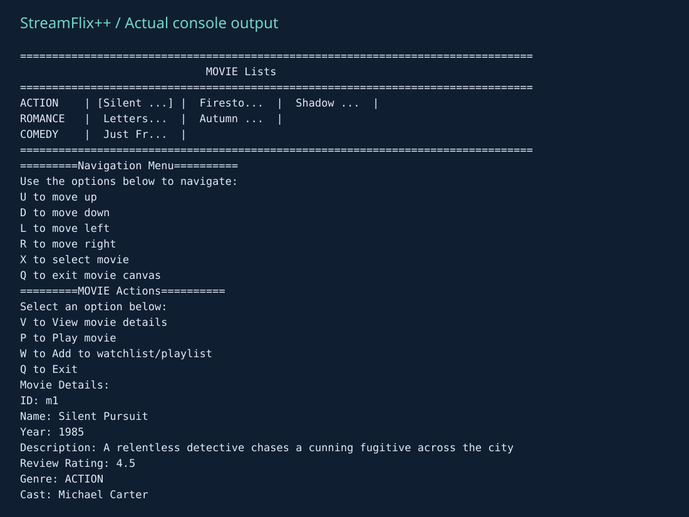
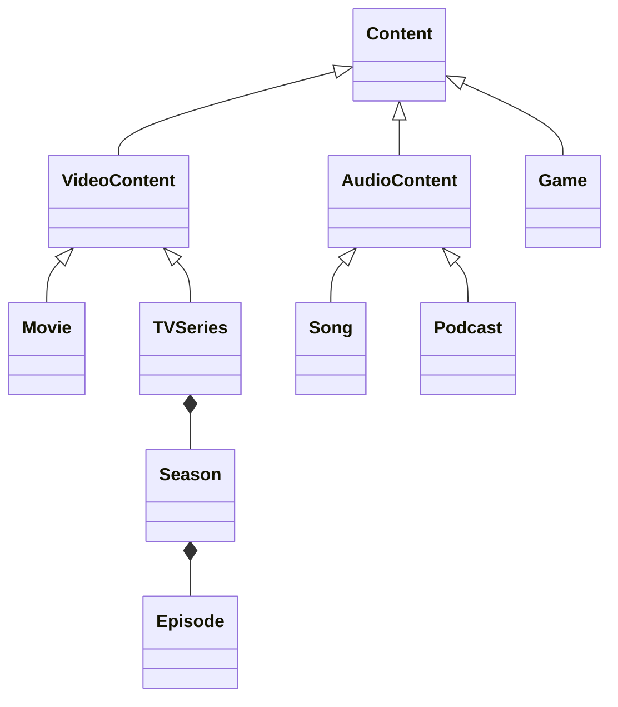

# StreamFlix++ · Media Library

[](https://github.com/yiqunqiao/streamflix-java/actions/workflows/ci.yml)


**Browse five media types, manage watchlists and playlists, and resume your session from CSV.**

A Java object-oriented application with a keyboard-driven catalogue. Playback is simulated in the console. The repository includes the catalogue and episode data needed to run it locally.



## Run in one command

Install JDK 21 and Python 3, then run from the repository directory:

```sh
python3 run.py
```

The launcher compiles all 27 Java files and starts a demo session. No Maven, Gradle, database or course-platform account is needed.

To use your own name or data files:

```sh
python3 run.py "Yiqun" 3 data/content.csv data/tvseries.txt
```

Arguments: user name, genre-row count, catalogue CSV, and television-episode file. `U/D/L/R` move the cursor, `X` selects an item, and `Q` returns. Enter `5` in the main menu to save and exit.

## What it does

| Area | Behaviour |
| --- | --- |
| Catalogue | Movies, TV series with seasons and episodes, songs, podcasts and games |
| Navigation | Genre-based media grids, keyboard movement and content details |
| User lists | Watch history, video watchlists and named audio playlists |
| Persistence | Saves and restores CSV sessions; prevents duplicate list items |
| Validation | Checks command-line arguments, malformed rows, missing files and menu input |

Sessions are created locally at `data/userSessionData.csv` and excluded from version control. The two bundled input files are fictional course sample catalogues.

## Design



`canvas/` handles menus and navigation, `content/` holds domain objects, and `loader/` parses catalogue, episode and session files. Enums and typed exceptions keep input rules separate from menu logic.

## Verification

```sh
python3 test_app.py
```

**Reference run: 11 November 2026 · OpenJDK 21.0.13 · Python 3.12 · 6/6 tests passed.** Tests launch real Java processes in temporary directories and cover all media canvases, watchlist deduplication, playback history, case-insensitive playlist lookup, session restoration, malformed rows and invalid arguments. [Full checklist](docs/validation.md).

## Project context

Developed by Yiqun Qiao within the University of Melbourne COMP90041 framework. Original source attribution is retained. This portfolio version restores the complete `Canvas.java` from the saved Ed workspace and adds bundled inputs, a launcher, regression tests and documentation.

